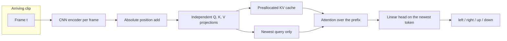
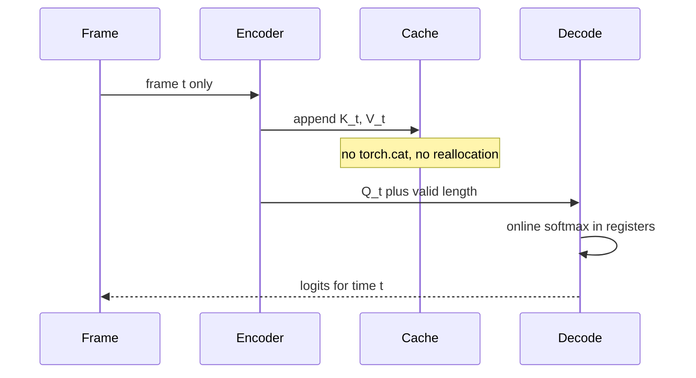
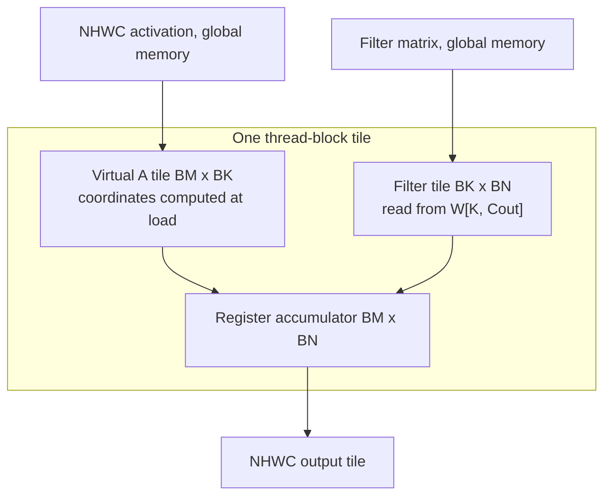

# StreamSight-CUDA

GPU-oriented streaming video inference: a small motion classifier used as a vehicle for FlashAttention-2, KV-cache decode, and implicit-GEMM convolution.

The question the code is built to answer is concrete. A 32×32 grayscale clip arrives a frame at a time. The label is the direction of a moving square or circle: left, right, up, or down. Two models share a CNN encoder. One reads the sequence with a left-padded temporal convolution. The other reads it with a single non-causal attention layer. Around that model, the repository compares the memory traffic of the obvious implementations with the traffic of the IO-aware ones.

This is a single-student study, not a production inference server and not a reimplementation of CUTLASS or FlashAttention-2. Where a kernel is simplified, the README says so. Where a number was not measured, the README does not invent one.

## What is library code, and what is ours

| Piece | Origin | Role |
| --- | --- | --- |
| PyTorch SDPA and `Conv2d` / cuDNN | PyTorch | Training reference, and the library baselines in the benchmarks |
| Materialized `QK^T → softmax → V` | This repo, Python | Shows the score matrix the fused kernels avoid |
| `F.unfold` + GEMM | This repo, Python | Explicit im2col baseline |
| `flash_attn.flash_attn_func` | Dao-AILab FlashAttention-2 | Full-prefix attention on a supported NVIDIA GPU. The source is not copied into this tree |
| `cuda/decode_attention.cu` | This repo | FP32 single-query online-softmax decode over a preallocated KV cache |
| `cuda/implicit_gemm_conv.cu` | This repo | FP32 tiled GEMM whose A tile is gathered from convolution coordinates |

Training always uses the PyTorch attention backend. There is no custom backward kernel. FlashAttention-2 and the CUDA decode kernel are inference paths. If you ask for one of them and it cannot run, the process raises. It does not silently call PyTorch under that name.

## Pipeline



The temporal CNN replaces the attention block with two kernel-3 convolutions along time, left-padded by 2, and classifies the last timestep. Its receptive field is five frames. The transformer’s newest token can see the whole prefix that has arrived.



Attention inside a prefix is **not causal**. A causal mask is not built anywhere in the model. Streaming is “only pass frames that exist,” and the loss reads the newest position. That newest output matches incremental decode because K and V are functions of one frame plus its absolute position. An earlier position in a full-prefix forward can see later frames; those earlier outputs are not the streaming outputs, and the tests do not pretend they are.

A second unmasked layer would break the cache. Its K/V would depend on attention outputs that already mixed the future of the prefix. The MVP is one layer on purpose.

## 1. Why a streaming video pipeline

The clip is short, but the access pattern is the one that shows up in streaming inference: the past is known, the future is not, and throwing the prefix away to recompute it is pure traffic. Direction is not painted into the first frame. Starts are drawn from a window in which every direction is legal, without looking at the label, and some interior frames are blank while the latent trajectory keeps moving. The held-out split is the same generator with a different seed stream.

## 2. Why convolution is the baseline

The encoder has to keep position. A global average pool would make direction unreadable. Each frame goes through `Conv2d(1→16) → ReLU → MaxPool → Conv2d(16→32) → ReLU → AdaptiveAvgPool2d(4) → Linear(512→128)`. The 4×4 grid is coarse, which is the point of keeping it explicit: the temporal model has to work with a token that still moves when the object moves.

The temporal CNN is the non-attention sequence model. It is streaming-compatible because of the left pad, not because it has a KV cache. It cannot see more than five frames, so it is not expected to win or lose by default. Both models are trained and scored on the same splits.

## 3. How convolution becomes GEMM

For this 3×3, stride-1, padding-1 layer the output spatial size equals the input. The CUTLASS implicit-GEMM view is

```
M = N * H * W
N = Cout          (this N is the GEMM N, not the batch)
K = Cin * 3 * 3
C = A_virtual[M, K] × W[K, Cout]
```

`m` is `(n, oh, ow)`. `k` is `(cin, kh, kw)` with `kw` fastest, the same order as `F.unfold` and `weight.view(Cout, -1)`. PyTorch `conv2d` is cross-correlation:

```
ih = oh - 1 + kh
iw = ow - 1 + kw
```

CUTLASS’s published analytic `f(p, r) = p * stride + R - r - 1 + pad` flips the filter index, because that reference defines convolution with the flip. Using the flip here would disagree with `F.conv2d`. The kernel uses the unflipped map and says so in `cuda/implicit_gemm_conv.cu`. The tiling structure is still the implicit-GEMM structure.



## 4. Why a materialized im2col buffer hurts

Explicit im2col writes an activation matrix of shape `[N, Cin*9, H*W]`. Every input pixel is stored up to nine times. That buffer is extra capacity and extra bytes moved before the GEMM even starts. `explicit_im2col_conv2d` is exactly `F.unfold` followed by a matmul, and the benchmark records `theoretical_im2col_mb` beside the timed run. That column is a size, not a measured allocator peak.

## 5. What the educational implicit GEMM avoids

`implicit_gemm_conv.cu` never allocates that matrix. A 16×16 thread block walks K in steps of 8. Each step:

1. Threads cooperatively fill `__shared__` A from `load_virtual_a` (padding loads are zeros).
2. Threads fill `__shared__` B from the `[K, Cout]` filter, which is contiguous along Cout.
3. `__syncthreads()`, then each thread adds an 8-term outer product into one register.
4. `__syncthreads()` again before the next tile reuses the same shared arrays.

Filter loads along N are coalesced. Activation loads are gathers; a K tile spans kernel taps and channels, so they are not a dense copy. CUTLASS spends real engineering on predicated iterators, vectorized loads, multi-stage pipelines, and Tensor Core MMA. This kernel is scalar FP32 FFMA. It will often lose to cuDNN. That result, if you measure it, is a result, not an embarrassment to hide. cuDNN’s algorithm choice is internal: this project does not claim cuDNN is implicit GEMM, and it does not claim Tensor Core math it does not issue.

The Python mirror is `implicit_gemm_conv2d_reference`. It keeps an `[M, tile_k]` tile, not `[M, K]`. `scalar_implicit_gemm` is the same address function in a loop, used to lock the formula to `F.conv2d` on CPU. The trained encoder still uses `nn.Conv2d`. The convolution study is a separate benchmark, which is what the design asked for.

## 6. Why standard attention is expensive

For one head, standard attention forms `S = QK^T` of shape `[S, S]`, writes it, softmaxes it into `P`, writes that, then multiplies `PV`. The bytes that matter are the `S` and `P` round trips, not the `O(S·d)` outputs. At S = 2048, B = 16, H = 4, FP16, the score matrix alone is

```
16 * 4 * 2048 * 2048 * 2 bytes = 512 MiB
```

before softmax writes a second matrix. The video model’s S = 16 is tiny next to that; the attention benchmark therefore also sweeps longer synthetic sequences. The short model is timed separately in the streaming benchmark.

## 7. How FlashAttention cuts the IO

FlashAttention (Dao et al., 2022) keeps the same mathematical attention and changes the memory schedule. Q, K, and V are tiled. A block of scores is computed in on-chip memory, consumed by online softmax, and discarded. HBM sees Q, K, V, and O, not an `S×S` matrix. Online softmax (Milakov & Gimelshein) makes that legal: a row can be updated from a K/V block if you keep the running max `m` and the running sum of exponentials `ℓ`, and you rescale the output accumulator when the max moves.

## 8. What FlashAttention-2 changes

FlashAttention-2 (Dao, 2023) does not change the result. It changes the schedule so more of the GPU does matrix-multiply work:

- **Fewer non-matmul FLOPs.** The accumulator stays unnormalized. The division by `ℓ` happens once at the end of the row, instead of inside every K tile. On an A100 the paper’s point is that FP16 Tensor Core math is about 16× the throughput of FP32 non-matmul math, so softmax bookkeeping shows up in the profile even when it is a small fraction of the FLOP count.
- **Query-parallel thread blocks.** FlashAttention v1 parallelized over batch and heads, one block per head. v2 also parallelizes over query-row blocks. Long sequences with a small batch no longer leave SMs idle. The inner loop walks K/V; the outer loop does not have to.
- **Warps split Q, not K.** v1 split K and V across warps (“split-K”) and then reduced partial outputs through shared memory. v2 gives each warp its own query rows and a shared K/V tile, so the warps do not need that reduction.
- **Shared memory and registers.** Q/K/V tiles live in SRAM. Accumulators, `m`, and `ℓ` live in registers. Block sizes are typically 64 or 128 on a side; bigger tiles cut DRAM traffic until they spill registers or exceed the SM’s shared memory.

The paper reports roughly 2× over FlashAttention v1 and on the order of 50–73% of peak FLOP/s in the forward pass on A100, in the configurations they measured. Those are their numbers, on their GPUs. This repository does not repeat them.

## 9. What the KV cache stores

```
K, V: [batch, heads, max_context, head_dim]
```

Capacity is 256, head dim is 32, four heads. `append` writes the next free slot with `copy_`. `reset` zeroes and sets the length to 0. There is no `torch.cat`.

At time t the step is: encode frame t, add position t, project Q/K/V, append K and V, attend with Q_t over the valid prefix, residual + FFN, classify that vector. Historical frames are not encoded again and their projections are not recomputed.

The valid prefix view `[:, :, :length]` is not contiguous when the batch or head dimension has size greater than one, because the physical stride still spans `max_context`. The PyTorch reference may `.contiguous()` that view before SDPA. The CUDA kernel does not. It receives the base allocation and an integer length, and it stops the scan there. Padding the tail with zeros and attending over the whole capacity would be wrong: a zero key is an extra logit of `q·0`, which changes the softmax.

## 10. Prefill and decode are different problems

FlashAttention-2 prefill has many query rows. That is why query-parallel blocks and the warp split over Q pay off, and why not writing `S` is a large saving.

Decode has one new query per head. The `S` matrix is a vector of length `T`, not `T×T`. Query-parallelism collapses to a single row. You still have to read the whole KV cache; a fused kernel cannot avoid that. What the cache saves is the **projection** of old tokens (and the CNN, in this model). What the fused decode kernel saves is writing and rereading that score vector, plus the launch of separate softmax and matmul kernels. For T = 16 both effects are small. They grow for different reasons, which is why the streaming benchmark reports end-to-end time and attention-only time separately.

## 11. How the CUDA decode kernel works

`decode_attention_kernel` launches one warp per `(batch, head)`. Head dim is 32, so lane `i` owns channel `i`.

```
acc = 0, m = -inf, ℓ = 0
for t in 0 .. valid_length-1:
    score = warp_sum(q[lane] * K[t, lane]) / sqrt(32)
    m' = max(m, score)
    α  = exp(m - m')          # 0 on the first step
    p  = exp(score - m')
    ℓ  = α ℓ + p
    acc = α acc + p * V[t, lane]
    m  = m'
out[lane] = acc / ℓ
```

That is the FlashAttention-2 unnormalized recurrence, specialized to one query and a KV tile of one token. `m` and `ℓ` are duplicated across the warp and stay identical because every lane sees the same reduced score. The running output stays in registers. K and V are read coalesced: consecutive lanes read consecutive floats, 128 bytes per token. There is no shared-memory tile and no global score buffer. A reduction uses `__shfl_xor_sync`.

This is a poor match to a big GPU when `batch * heads` is small. Four warps cannot occupy an A100, and the KV loop is serial in `valid_length`, so latency grows roughly linearly with context. A production decode kernel would split K across more warps and merge the online-softmax state, or persistent-schedule many requests. Correctness was the constraint. The kernel is FP32, forward-only, one length per batch, no dropout, no paging, no causal mask.

`--use_fast_math` is intentionally off so `expf` stays closer to the FP32 reference.

## 12. How the implicit GEMM kernel is limited

Fixed workload: 3×3, stride 1, padding 1, FP32, NHWC, no groups, no bias. Tile sizes `BM = BN = 16`, `BK = 8`. Shared arrays are padded by one on the inner dimension to ease bank conflicts. The host checks that `K = Cin * 9` and that the launch grid fits in 65535 blocks per axis. There is no Tensor Core instruction in the source.

## 13. Benchmark method

Timers:

- CUDA: `torch.cuda.Event` around the callable, after warmup. This includes Python launch overhead. It is not Nsight kernel time.
- CPU: `perf_counter` around the same callable. Those numbers are CPU wall times. They are not GPU results and must not be read as speedups of FlashAttention or CUTLASS.

Also recorded when CUDA is present: `max_memory_allocated` after `reset_peak_memory_stats`, reported as bytes above the pre-call baseline. TF32 is disabled so FP32 baselines are actually FP32. cuDNN benchmark autotune is enabled only in the conv timing script, and warmup iterations are excluded from the median.

Theoretical tensor sizes are separate columns or printouts. They are not substituted for measured peaks.

Commands:

```bash
python benchmarks/benchmark_conv.py
python benchmarks/benchmark_attention.py
python benchmarks/benchmark_streaming.py --checkpoint checkpoints/transformer.pt

# Full attention sweep, NVIDIA GPU only. CPU defaults are shorter on purpose.
python benchmarks/benchmark_attention.py --device cuda \
  --seq-lens 128 256 512 1024 2048 --batches 1 4 16
```

CSV files land in `results/`. Plots are written next to them from rows whose status is `ok`. Unavailable backends are rows in the CSV, not zeros on the chart.

### Measurements collected in this workspace

The development machine used for the numbers below is a Mac (no NVIDIA GPU, no `nvcc`). Every CUDA, cuDNN, and FlashAttention-2 row is **unavailable**. The figures that follow are CPU wall-clock medians from the scripts above, written to `results/*.csv` by that run. They are not GPU kernel times.

See the “Local CPU run” section at the end of this file. It is filled from the CSV after the scripts run in this environment. If that section says a script was not run, it was not run.

## 14. Limits

- One attention layer, dropout 0, max context 256, four heads of dimension 32.
- Non-causal prefix attention. Only the newest token is trained and compared to the cache.
- Custom decode is FP32, one warp per head, no backward, no paged cache, uniform batch length.
- Official FlashAttention-2 is an optional import. It needs a CUDA build of the Dao-AILab package and, for the usual builds, Ampere or newer. FP16/BF16 only. `causal=False`.
- Implicit GEMM is one constrained FP32 kernel. It is not CUTLASS and it is not wired into the trained CNN.
- Synthetic data only. Occlusion and the shared start window remove the obvious shortcuts; they do not make this a video-understanding benchmark.
- Nsight Compute is documented and optional. Nothing in `pytest` or `train.py` requires it.

## Layout

```
streamsight-cuda/
  data/synthetic_video.py      generator and Dataset
  data/visualize.py            sample grid
  models/frame_encoder.py
  models/temporal_cnn.py
  models/temporal_transformer.py
  models/conv_mapping.py       explicit im2col, tiled reference, scalar address map
  inference/attention_backends.py
  inference/kv_cache.py
  inference/streaming.py
  inference/cuda_backend.py    raises if the extension is missing
  cuda/decode_attention.cu
  cuda/implicit_gemm_conv.cu
  cuda/bindings.cpp
  benchmarks/                  conv, attention, streaming, plots, ncu launcher
  tests/
  train.py
  demo.py
  setup.py
```

## CPU setup

Python 3.10+ is required. CUDA is not.

```bash
cd streamsight-cuda
python3 -m venv .venv
source .venv/bin/activate
pip install -r requirements.txt

python -m pytest -rs
python data/visualize.py --out results/sample_sequences.png
python train.py --model cnn --smoke
python train.py --model transformer --smoke
python demo.py --model cnn --no-train-if-missing
python demo.py --model transformer --backend torch --no-train-if-missing
python demo.py --model transformer --backend torch --streaming --no-train-if-missing
```

Longer training, still the PyTorch backend:

```bash
python train.py --model cnn --epochs 8 --train-size 1024 --val-size 256 --test-size 256 --batch-size 32
python train.py --model transformer --epochs 8 --train-size 1024 --val-size 256 --test-size 256 --batch-size 32
```

Checkpoints go to `checkpoints/cnn.pt` and `checkpoints/transformer.pt`. The test split is touched once, after the best validation epoch is restored.

`--backend flash2` or `--backend cuda` on `train.py` exits. Those paths have no backward implementation here.

## CUDA build

On Linux, with an NVIDIA driver, a CUDA toolkit, and a CUDA build of PyTorch:

```bash
python setup.py build_ext --inplace
python -m pytest -rs
python demo.py --model transformer --backend flash2 --no-train-if-missing
python demo.py --model transformer --backend cuda --streaming --no-train-if-missing
```

`flash2` runs official FlashAttention-2 on the whole prefix. `cuda --streaming` runs `decode_attention.cu` one frame at a time. Passing `--backend cuda` without `--streaming` exits, because the custom kernel is not a prefill kernel. Passing `--backend flash2 --streaming` also exits, so the two are not interchangeable labels.

Install FlashAttention-2 separately if you want that backend. It is not in `requirements.txt` and it is not vendored:

```bash
pip install flash-attn --no-build-isolation
```

On a Mac, or any machine where `torch.cuda.is_available()` is false, `python setup.py build_ext` exits with the reason. Pytest skips the kernel tests. Skip is not a pass.

## Nsight Compute

Not required for training or tests.

```bash
bash benchmarks/profile_nsight.sh
```

The script runs `ncu --set full` on `benchmarks/profile_once.py`, which launches each custom kernel once. In the report, the useful sections are launch statistics (registers, shared memory, grid), occupancy, memory workload analysis (DRAM throughput, sector utilization, coalescing), and warp state statistics (long-scoreboard stalls versus math).

Expect the decode kernel’s time to track `valid_length`, and expect low occupancy when `batch * heads` is a handful of warps. Expect the convolution kernel’s DRAM traffic to track `Cin * 9` and to show uncoalesced activation gathers. Changing `BM`, `BN`, and `BK` would move the register and shared-memory balance; those tile sizes are constants in the MVP, not a tuned sweep.

## Tests

| File | What a CPU run actually checks |
| --- | --- |
| `test_dataset.py` | shapes, balance, reproducibility, trajectories, occlusion, start-position probe |
| `test_models.py` | encoder, both models, gradients, left-pad causality, history sensitivity |
| `test_kv_cache.py` | append, reset, overflow, projection cache, streaming versus prefix |
| `test_attention.py` | explicit versus SDPA, online softmax including length 1024, large logits, non-causal behavior |
| `test_cuda_kernels.py` | tiled and scalar implicit GEMM versus `conv2d` and im2col; source contract of both kernels |

CUDA runtime tests in `test_cuda_kernels.py` (decode at context 1, 16, 128, 256, 1024 and batches 1, 4, 16; implicit GEMM shapes; streaming versus prefix) skip until `streamsight_cuda_kernels` is imported and `torch.cuda.is_available()` is true. FlashAttention-2 comparisons skip until `flash_attn` imports on an SM80+ GPU. The skip message is the reason, not a green stand-in.

## References

- Tri Dao, Daniel Y. Fu, Stefano Ermon, Atri Rudra, and Christopher Ré. *FlashAttention: Fast and Memory-Efficient Exact Attention with IO-Awareness.* NeurIPS 2022. <https://arxiv.org/pdf/2205.14135>
- Tri Dao. *FlashAttention-2: Faster Attention with Better Parallelism and Work Partitioning.* 2023. <https://arxiv.org/html/2307.08691v1>
- NVIDIA CUTLASS. *Implicit GEMM Convolution.* <https://docs.nvidia.com/cutlass/4.3.2/media/docs/cpp/implicit_gemm_convolution.html>
- Maxim Milakov and Natalia Gimelshein. *Online normalizer calculation for softmax.* 2018. The recurrence FlashAttention uses to tile softmax.

## Local CPU run

Measured on this Mac (Darwin, Python 3.13, PyTorch 2.15.0 CPU, no NVIDIA GPU, no `nvcc`).

```text
python -m pytest -rs --tb=line
30 passed, 22 skipped in 0.48s
```

Passed on CPU: dataset shape, balance, reproducibility, trajectories, occlusion, and the start-position probe; CNN and transformer forward/backward; left-padded temporal convolution; KV-cache append/reset/overflow; full-prefix versus streaming logits; explicit attention versus SDPA; online softmax at lengths 1, 16, 128, 256, and 1024; large-score stability; non-causal behavior; tiled and scalar implicit GEMM versus `F.conv2d` and explicit im2col, including the hand-checked 3×3 corner/edge/center values.

Skipped, and not counted as passes:

- 2 FlashAttention-2 tests: `CUDA is not available. Official FlashAttention-2 was not executed.`
- 20 CUDA kernel tests (decode at context 1/16/128/256/1024 and batches 1/4/16, implicit GEMM shapes, CUDA streaming): `streamsight_cuda_kernels` is not built. Import error: `No module named 'streamsight_cuda_kernels'`.

No latency CSV was produced here, so this README does not quote kernel milliseconds. Run the benchmark commands above on the machine you care about; the scripts write `results/*.csv` and skip unavailable backends instead of substituting PyTorch.
